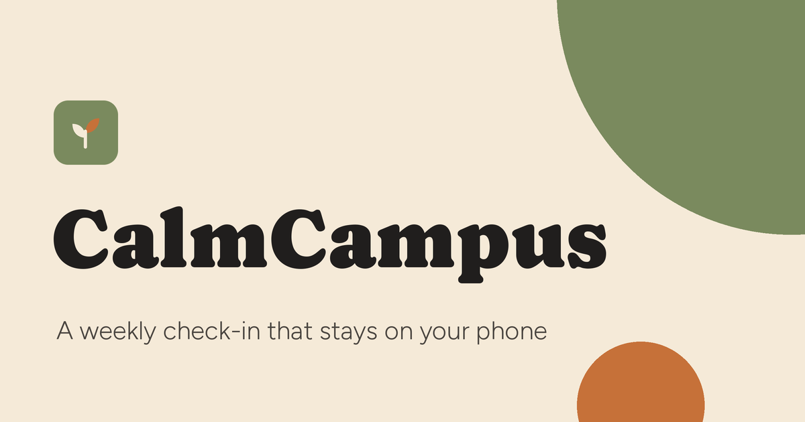

# CalmWeb

[](https://github.com/CalmCampus-FV/CalmWeb/actions/workflows/ci.yml)
[](LICENSE)


**The website of CalmCampus**, a privacy-first wellness companion for university students: the marketing site (hub, universities, companies, app), the impact report and the evidence dossier behind their claims. Live at [**calmcampus.app**](https://calmcampus.app/) (cc.braunf.com redirects there, path preserved).

<p align="center">
  
</p>

## What's here

| Path | What it is |
|---|---|
| [`docs/`](docs/) | The site. Plain HTML/CSS/JS, no build step: `index.html` (hub), `universities/`, `companies/` and `app/` (one `index.html` each), `report.html` (impact report), shared `tokens.css`, and frozen copies of the public form pages (`f/`, `forms/`; source: [CalmForms](https://github.com/CalmCampus-FV/CalmForms), sync with `bash scripts/sync-forms.sh`, never edit here) |
| [`docs/quivr/`](docs/quivr/), [`docs/demo/`](docs/demo/), [`docs/epfl/`](docs/epfl/), [`docs/unil/`](docs/unil/) | The university demos, live at [/quivr/](https://calmcampus.app/quivr/), [/demo/](https://calmcampus.app/demo/) (the general preview, "Try the demo" on the home page), [/epfl/](https://calmcampus.app/epfl/) and [/unil/](https://calmcampus.app/unil/) (their main address is now [uni.calmcampus.app](https://uni.calmcampus.app/)). **Published copies only: the source is [CalmUni](https://github.com/CalmCampus-FV/CalmUni)** (`web/` and `published/<demo>/`). Change them there, then run `bash scripts/sync-demos.sh` here. Never edit them in this repo, and never move or rename them: these links have been sent to universities |
| [`scripts/`](scripts/) | The site check and the two sync scripts (`sync-demos.sh`, `sync-forms.sh`) |
| [`research/`](research/) | Evidence dossier (PDF), source index (`index.csv`, one row per cited paper), notes and research log |

Related repositories: the forms platform is [CalmForms](https://github.com/CalmCampus-FV/CalmForms), the iOS app is [CalmApp](https://github.com/CalmCampus-FV/CalmApp), university demos are [CalmUni](https://github.com/CalmCampus-FV/CalmUni), company demos are [CalmBiz](https://github.com/CalmCampus-FV/CalmBiz), and the on-device model research and design mockups are archived in [CalmCampus](https://github.com/CalmCampus-FV/CalmCampus).

## Demos from CalmUni

calmcampus.app is this repo's GitHub Pages site, and the links already sent on cc.braunf.com redirect here with the same path, so the demo copies must stay here to keep those links working. [CalmUni](https://github.com/CalmCampus-FV/CalmUni) is where they are built and kept (`published/<demo>/`). To publish a change:

```bash
bash scripts/sync-demos.sh        # copies every published/<demo>/ from CalmUni main into docs/<demo>/
git checkout -b sync-demos && git add docs && git commit -m "Sync demos from CalmUni" && git push -u origin sync-demos
```

Open a PR and squash-merge once CI is green. The **Source sync** workflow (`.github/workflows/demo-sync.yml`, on every PR, on `main` and daily) fails when `docs/<demo>/` differs from CalmUni, so a missed sync shows up. It reads the public CalmUni repo and needs no secret. Publishing straight from a CalmUni Action would need a cross-repo token secret, so it is deliberately not set up.

## Forms

The forms platform (builder, public forms, admin, Worker, database) moved to **[CalmForms](https://github.com/CalmCampus-FV/CalmForms)** with its history; see its FORMS.md. The form links already sent (`cc.braunf.com/f/<slug>`) keep working: this repo serves frozen copies of `docs/f/` and `docs/forms/`, and the Cloudflare Worker keeps its routes on cc.braunf.com (the cc.braunf.com redirect sends /f/* and /forms/* to form.calmcampus.app and leaves /api/* alone). New form links use form.calmcampus.app. The **Source sync** workflow fails when those copies drift from CalmForms; fix it with `bash scripts/sync-forms.sh` and a PR.

## Run it locally

The site alone needs nothing installed:

```bash
python3 -m http.server 3400 --directory docs
```

`research/papers/` (the downloaded PDFs) is gitignored. Run `research/download_papers.sh` to fetch it again.

## Deployment

GitHub Pages serves `main` from `/docs`, with the domain set in [`docs/CNAME`](docs/CNAME). Pushing to `main` publishes the site and the public form pages.

The forms Worker and admin are deployed from CalmForms, see its FORMS.md.

Domains: `docs/CNAME` is `calmcampus.app` (a Pages site has one custom domain). cc.braunf.com is kept as a fallback by Cloudflare redirect rules in the braunf.com zone: `/f/*` and `/forms/*` go to form.calmcampus.app, everything else except `/api/*` goes to calmcampus.app, path and query string preserved. Keep `docs/quivr`, `docs/demo`, `docs/epfl`, `docs/unil`, `docs/f` and `docs/forms` here so every link already sent still resolves at the same path.

## Checks

CI runs the site check (every local link resolves, and no page, stylesheet or script loads anything from another host). Run it before you push:

```bash
python3 scripts/check-site.py
```

## Principles

- **Every claim has a source.** Numbers on the site trace to a row in `research/index.csv`.
- **Wellness wording, not medical claims.** The product "supports", it does not "detect burnout".
- **No trackers.** No analytics, third-party scripts, fonts or embeds, matching the app's on-device promise. Where a form stores data on a server, it says so.

## Contributing

Corrections to a claim or source are especially welcome, see [CONTRIBUTING.md](CONTRIBUTING.md) and the [Code of Conduct](CODE_OF_CONDUCT.md). To report a security problem, see [SECURITY.md](SECURITY.md).

## Team

- **Florian Braùn**: Engineering Technology
- **Hélène David**: Economics and Business

## License

[MIT](LICENSE). The CalmCampus name and logo are not covered by the license.
